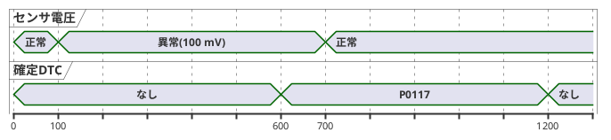

# 水温センサ故障検出

テスト: [ect_sensor_diag.feature](../../tests/features/ect_sensor_diag.feature)

## 目的

水温センサが壊れたときにそれを検出して記録し、エンジン制御が極端な値で動かないようにする。

## 振る舞い

- センサ電圧が正常範囲を外れた状態が**連続して**デバウンス時間以上続いたら、DTC を確定する
  - 下限未満: P0117（断線など）
  - 上限超え: P0118（ショートなど）
- 異常が途中で途切れたら、継続時間は数え直す
- DTC 確定中は、制御用水温を実際の水温ではなくフェールセーフ値にする
- 電圧が正常範囲に戻って、デバウンス時間続いたら DTC を解除する

## パラメータ

| 名前 | 値 | 意味 |
|---|---|---|
| ECT_MV_MIN | 200 mV | これ未満は異常 (P0117) |
| ECT_MV_MAX | 4800 mV | これを超えたら異常 (P0118) |
| ECT_DEBOUNCE_MS | 500 ms | 確定・解除に必要な継続時間 |
| ECT_FAILSAFE_C | 80 ℃ | 故障中の制御用水温 |

200 mV と 4800 mV ちょうどは正常とする。

## 時間の動き（断線の例）

